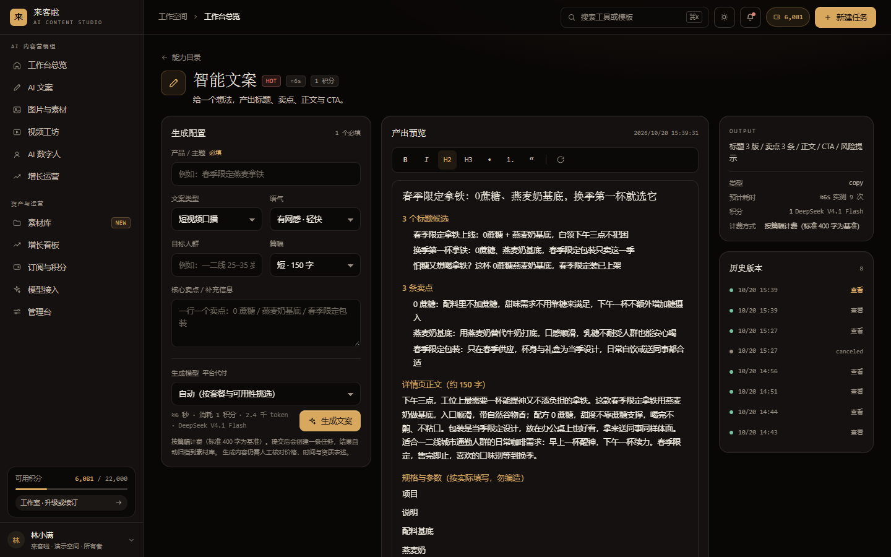
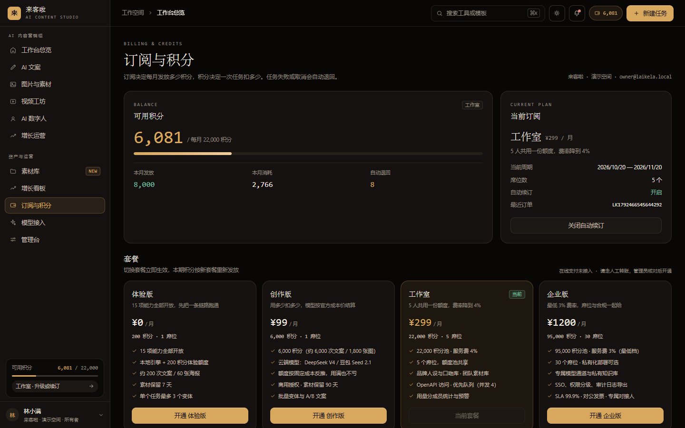
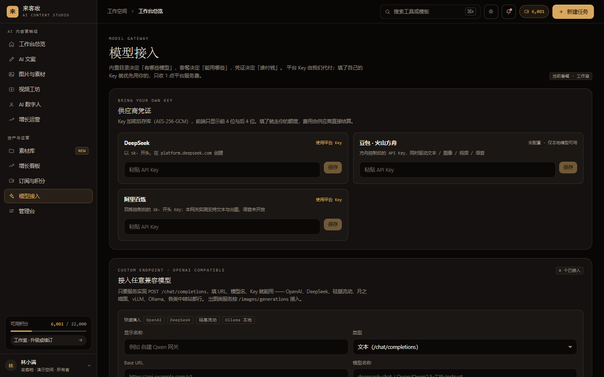
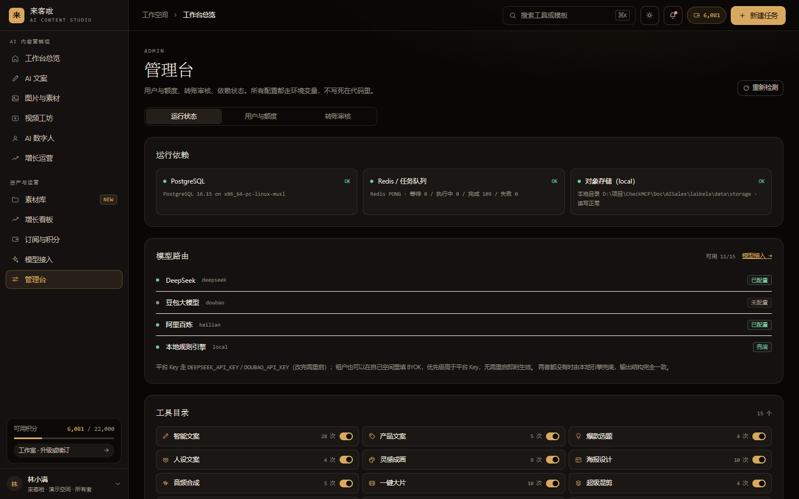
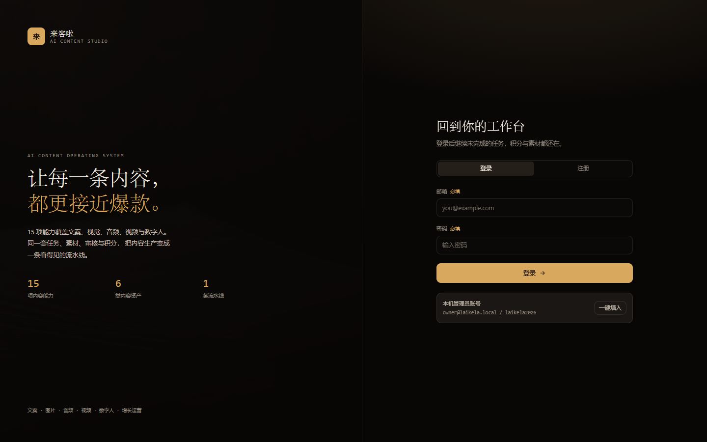

[](https://github.com/MathsionYang/Laikela)

[简体中文](README.md) | [**English**](README.en.md)

[**Live Demo**](https://mathsionyang.github.io/Laikela/): a static preview of the application. Browse the interfaces without signing in; generation, uploads, payments, and saving require the backend and are unavailable in this demo. The application interface is currently in Chinese; the language links above switch the documentation only.

### Content as Workflow | 15 AI content tools, one task lifecycle, from input to credit settlement


[Quick Start](#quick-start) · [15 Tools](#15-tools) · [Core Design](#core-design) · [Credit Ledger](#credit-ledger) · [Accounts and Payments](#accounts-and-payments) · [Model Integration](#model-integration) · [API Reference](#api-reference) · [Known Limitations](#known-limitations) · [Author](#author) · [License](#license)

---

## What Is Laikela?

Laikela is an AI content production workspace for small and medium-sized businesses. It brings copywriting, visuals, audio, video, digital avatars, and growth research into a traceable workflow, from an initial idea to content assets ready for review and publication.

Three design choices distinguish it from a chat interface:

- **Structured tools instead of free-form prompts.** Each of the 15 tools defines its own fields, such as product category, selling points, platform, duration, voice, and palette. The system builds prompts from schemas and returns editable Blocks rather than an unstructured wall of text.
- **Tasks instead of single requests.** Long-running work enters a queue. Server-Sent Events (SSE) report progress, refreshing the page preserves task state, and failed or canceled tasks refund their credits automatically.
- **Pluggable model routing instead of a hard-coded SDK.** Built-in models and custom OpenAI-compatible endpoints share a routing layer. Platform credentials, tenant-provided keys (BYOK), and custom endpoints can coexist.

The UI uses a dark, gold-accented editorial style with serif headings and monospaced metadata. The original requirements and prototype references mentioned in the Chinese README are local design inputs, not prerequisites for running this repository.

---

## Screenshots

These screenshots show the locally running application through `npm run serve`, including task results, assets, credit usage, and costs. They are separate from the isolated data used by the static Pages demo.

**Workspace:** monthly output, review pass rate, running tasks, remaining credits, a 30-day production chart, and the generation queue.


**All tools:** tools grouped into copywriting, images, video, avatars, and growth, with time estimates, credit quotes, and usage counts.


**Smart copywriting:** structured inputs, editable Blocks, model and billing details, and historical versions in one workspace.



**Asset library:** previews, downloads, and deletion for text, images, audio, video, storyboards, and intermediate files.


**Subscriptions and credits:** balance, monthly grants, spending, refunds, and a comparison of four subscription tiers.



**Model integration:** platform credentials, encrypted BYOK, and custom endpoints configured with a base URL and model ID.



**Administration:** dependency health, model availability, the tool catalog, and usage.



**Sign-in:** email-code registration and a prefill option for the local demo administrator.



---

## Quick Start

Use Node.js 20 or newer. Docker is optional for local evaluation; PostgreSQL 16 and Redis 7 are recommended for a multi-process deployment.

```bash
# 1. Start PostgreSQL 16 and Redis 7.
docker compose up -d

# 2. Install dependencies.
npm install

# 3. Copy the example configuration and adjust it as needed.
cp .env.example .env

# 4. Start the web app and worker together.
npm run dev:all
# Alternatively: npm run dev and npm run worker in separate terminals.

# 5. For production, build and start the web app.
npm run build && npm start
# Start npm run worker separately when using the Redis queue.

# 6. Validate pricing rules after changing prices or billing units.
npm run check:margin
```

On Windows PowerShell, use `Copy-Item .env.example .env` instead of `cp` if preferred.

### One-Command Local Startup

Double-click `start.bat` on Windows, or use the cross-platform launcher:

```bash
npm run serve                  # Production mode on port 3000.
npm run serve -- --dev         # Development mode; skip the production build.
npm run serve -- --port=3100   # Use a different port.
npm run serve -- --force       # Terminate the process occupying the selected port.
npm run serve -- --no-docker   # Do not attempt to start Docker.
npm run serve -- --check       # Also check billing rules and AI connectivity.
```

The launcher checks Node.js and dependencies, starts infrastructure when available, falls back to PGlite and an in-process queue without Docker, checks the port, rebuilds when source files have changed, and waits for `/api/health`. `Ctrl+C` also terminates its Next.js child process.

Open <http://localhost:3000> and sign in with the local demo account:

| Email | Password | Role | Initial Plan |
| --- | --- | --- | --- |
| `owner@laikela.local` | `laikela2026` | Workspace owner and platform administrator | Studio; 22,000 credits/month |

These are development credentials, not production secrets. Replace development signing secrets and secure or remove the seeded demo account before exposing a full backend deployment publicly.

With `DB_DRIVER=auto`, the app tries PostgreSQL and falls back to embedded PGlite. `QUEUE_DRIVER=auto` similarly falls back from Redis to an in-process queue. These fallbacks are intended for local or single-process use, not multi-instance deployment. Run `npm run doctor` or request `GET /api/health` to see the active drivers.

### Startup and Billing Troubleshooting

| Symptom | Cause | Action |
| --- | --- | --- |
| An upgraded plan still shows the old credit allowance | Older grant logic treated the month's credits as already issued | `topUpMonthly()` now grants only the difference. Preview existing-account repairs with `npm run fix:plan-gap`; add `-- --apply` to write changes. |
| Login succeeds but the session immediately disappears | `COOKIE_SECURE=1` on plain HTTP prevents the cookie from being sent | Leave it unset or use `0` locally; enable it behind HTTPS. |
| A provider key changed in `.env` has no effect | Environment credentials are read at module load | Restart the process. BYOK and custom endpoint changes apply immediately. |
| A job stays `queued` | No queue worker is running | Run `npm run worker` or `npm run dev:all`. |
| `start.bat` prints garbled text or command-not-found errors | Encoding or line-ending changes broke batch parsing | Keep the batch file ASCII with CRLF, as enforced by `.gitattributes`; put localized output in Node.js instead. |

---

## 15 Tools

Credits below are local-engine examples. Cloud pricing changes with the selected model. Durations are baseline estimates; the application uses measured medians from comparable successful jobs when available.

Billing scales with output: images by count, video by seconds, audio by character count, and copy by its length tier. Tool cards, configuration previews, and task submission all use `quoteCost()`.

### Copywriting

| Tool | Key Inputs | Output | Baseline | Local Credits |
| --- | --- | --- | --- | --- |
| Smart copy `copy-smart` | Idea or topic | Headlines, selling points, body, CTA | 20s | 1 |
| Product copy `copy-product` | Product details, audience | Customer-facing benefits | 25s | 1 |
| Trending topics `copy-topic` | Niche, platform, trends | Actionable topic ideas | 30s | 1 |
| Persona copy `copy-persona` | Tone, values | Reusable writing persona | 20s | 1 |

### Visuals

| Tool | Key Inputs | Output | Baseline | Local Credits |
| --- | --- | --- | --- | --- |
| Image generation `image-gen` | Description, reference, style | Visual asset candidates | 40s | From 3 per image |
| Poster design `image-poster` | Theme, headline, date, palette | Social media posters | 35s | 7 for 3 images |
| Cover design `growth-cover` | Keyframe, copy, style | Cover candidates | 40s | From 7 |

Poster and cover text is rendered using real fonts through sharp and SVG, rather than relying on image models to draw Chinese characters. Specialized handwritten effects are not supported.

### Video and Avatars

| Tool | Key Inputs | Output | Baseline | Local Credits |
| --- | --- | --- | --- | --- |
| One-click movie `video-movie` | Assets or theme, duration, pacing | Video composition with transitions, subtitles, and music | 180s | 16 for 15 seconds |
| Batch remix `video-mix` | Openings, background music, subtitles | Combination-based variants | 300s | 53 for 50 seconds |
| Store promotion `video-store` | Store, offers, event | Local store promotional content | 120s | 32 for 30 seconds |
| Talking avatar `avatar-talking` | Script, appearance, voice | Presenter-style content | 90s | From 16; script length converted to seconds |
| Social video `avatar-net` | Assets, platform | Styled captions, stickers, comments, sound effects | 120s | 21 for 20 seconds |

Local video output consists of storyboard keyframes and a timeline, not an encoded MP4. Finished cloud video depends on provider availability; see [Known Limitations](#known-limitations).

### Audio

| Tool | Key Inputs | Output | Baseline | Local Credits |
| --- | --- | --- | --- | --- |
| Audio synthesis `audio-tts` | Script, voice, speed, music | Aligned voice, music, and effects track | 25s | From 1; billed per thousand characters |

### Growth

| Tool | Key Inputs | Output | Baseline | Local Credits |
| --- | --- | --- | --- | --- |
| Trend research `growth-trend` | Niche, platform | Rising topics and follow-up content | 30s | From 1; scales with item count |
| Video reverse engineering `growth-reverse` | Reference video | Reusable structure and storyboard | 40s | 1 |

---

## Core Design

### Task State Machine

```text
queued -> running -> post_processing -> reviewing -> succeeded
```

Failures enter `failed`; cancellation enters `canceled`. Both trigger an idempotent refund.

- SSE at `/api/jobs/[id]/events` streams progress, with polling as a fallback.
- Jobs persist the selected `model_key` at creation and recheck plan eligibility before execution.
- BullMQ/Redis and the in-process queue run the same `pipeline.ts` implementation.

### Credit Ledger

Balances are calculated from ledger entries: `balance = sum(delta)`. There is no separate balance field to drift out of sync.

| Design | Implementation | Purpose |
| --- | --- | --- |
| Concurrency safety | `pg_advisory_xact_lock(hashtext(org_id))` | Serialize credit changes within a tenant. |
| Idempotency | Unique `idempotency_key`, including `job:<id>:consume` and `job:<id>:refund` | Prevent duplicate charges or refunds on retries. |
| Monthly allowance | `grant:<org>:<calendar-month>` and differential top-ups | Prevent repeated plan changes from granting duplicate monthly credits. |
| Refund amount | Absolute value of the job's actual consumption entry; `applied:false` when no charge exists | Prevent refunds from creating unearned credits. |

`src/lib/domain/pricing.ts` is the pricing source of truth. `ToolDef.billing` converts inputs and outputs into billing units, and `quoteCost()` is shared by cards, previews, and submission.

### Subscriptions

Four tiers are defined: `free`, `creator`, `studio`, and `enterprise`, backed by `plans`, `subscriptions`, and `orders`.

- A partial unique index on `subscriptions(org_id) WHERE status='active'` enforces one active subscription per tenant.
- Monthly allowances represent the total entitlement for the calendar month, not a new grant for every plan change. Upgrading from 200 to 95,000 credits adds 94,800; repeated changes do not duplicate grants, and downgrades do not reclaim issued credits.
- `topUpMonthly()` reads existing grants and writes the difference under the same tenant lock.
- Cancellation sets `cancel_at_period_end`. It does not refund the current period and can be reversed.

### Replay Historical Versions

Selecting a historical version restores its input parameters to the form. Editing and submitting creates a new task rather than changing the old one.

- Restore `jobs.input` and `jobs.model_key`, not historical output, duration, or cost. A new task uses current pricing.
- Normalize retired options, clamp numeric values to the current schema, and discard removed fields.
- Set `parent_job_id` for provenance; preserve the original task and its billing records.
- Confirm before overwriting unsaved form edits; repeated selection of the same version does not repeatedly reset the form.

See [the replay specification](docs/REPLAY-PARAMS.md), currently in Chinese, for edge cases.

---

## Assets: Save, Preview, Download, Delete

Task outputs are persisted and surfaced through the asset library.

| Output | Files | Billing Unit | Presentation |
| --- | --- | --- | --- |
| Copy | UTF-8 `final.md` | Thousand tokens / length tier | Summary card and full-text preview |
| Images | `final-1..n.png`, `thumb-1..n.webp` | Image | 240px thumbnail and original preview |
| Audio | `mix.wav` or `mix.mp3` | Thousand characters | Native audio player |
| Video | Cloud `final.mp4`, or local `shot-*.png` and `timeline.json` | Second | Native video player or storyboard |

- Local storage defaults to `./data/storage/{orgId}/jobs/{jobId}/...`. `STORAGE_DRIVER=s3` keeps the same key layout in S3-compatible storage.
- Downloads use `/api/assets/[id]/download`, with asset names encoded through RFC 5987, rather than exposing storage-key filenames through signed URLs.
- Deletion removes files, thumbnails, historical versions, and database rows. The UI asks for confirmation. Locked-file cleanup failures are logged, and reported deletion counts include only files actually removed.
- Saving edited copy updates the corresponding `.md` asset.
- Thumbnail rows use `role='thumbnail'` and are not separate library entries.
- The default library lists `final` and `original` assets. Storyboard `proxy` frames and `metadata` timelines appear in their dedicated categories.
- `npm run assets:dedupe` previews duplicate cleanup; `-- --apply` performs it. Keep/delete decisions are backed up under `data/backup/dedupe-assets-<timestamp>.json` before execution.
- `npm run assets:gc` finds unreferenced local files; `-- --apply` removes them.

### Quotes, Execution, and Fallback Billing

`/api/tools` uses the same `resolveModel` and `quoteCost` as task submission. Time estimates use successful jobs from the preceding 90 days, separating local and cloud runs and excluding demo or degraded samples.

A key that last returned 401 is not permanently disabled, but automatic selection ranks it below the local engine. If cloud execution falls back locally, `output.billing` records `charged`, `actual`, and `refunded`. Overcharges are refunded; fallback never adds a surprise charge after submission.

---

## Accounts and Payments

### Email Verification Before Sessions

`POST /api/auth/register` creates an account and sends a six-digit code but does not create a session. `POST /api/auth/verify-email` creates the session after verification. Login by an unverified account returns `403 EMAIL_UNVERIFIED`; the UI opens verification and resends a code.

- Codes avoid the link-prefetch behavior of some corporate email scanners.
- Only `HMAC-SHA256(serverSecret, userId:code)` is stored, not the plaintext code or a brute-forceable unsalted hash.
- Database-backed limits enforce a 60-second resend cooldown, six emails per hour, invalidation after five incorrect attempts, and a 15-minute expiry. New codes invalidate old ones.
- Without SMTP, the `outbox` driver writes to `mail_outbox` and the console. Local `MAIL_DEBUG_CODE=1` can return the code for testing; production does not expose it in API responses.
- A one-time migration marks pre-existing accounts as verified, avoiding accidental lockout.

### Platform Administration

`users.is_admin` is separate from workspace roles (`owner`, `admin`, `member`). Administrators can be promoted in the database or through the `ADMIN_EMAILS` environment variable. The seeded local demo owner is a platform administrator.

| Admin Tab | Capabilities |
| --- | --- |
| Runtime status | Dependency checks, model routing, tool catalog, monthly usage |
| Users and allowances | Search users, adjust credits, change plans, inspect balances and verification status |
| Transfer review | Approve or reject payment declarations; apply a plan and bonus credits |

Each administrative change writes who changed what, for which tenant, and why to `admin_audit_log`.

### Manual Transfers

Manual transfer is the current payment workflow while provider merchant integration is unavailable:

```text
User views payment instructions at /billing
  -> transfers funds -> declares amount, reference, and payer
  -> manual_payments(status=pending)
Admin verifies the transfer at /admin
  -> approves a plan and credits, or rejects with a reason
  -> conditional update WHERE status='pending'
  -> idempotent credit grant + subscription update + audit log
```

Transfer references cannot be declared twice. Each tenant may have at most three pending declarations. Conditional review updates and `manual:<reference>:bonus` idempotency keys prevent duplicate grants under concurrent approval or retries.

---

## Model Integration

| Mode | Configuration | Who Pays | Takes Effect | Typical Use |
| --- | --- | --- | --- | --- |
| Platform-managed keys | `.env`: `DEEPSEEK_API_KEY`, `DOUBAO_API_KEY`, `BAILIAN_API_KEY` | Platform | After process restart | Shared provider access |
| Tenant BYOK | `/settings/models`, provider credentials | Tenant | Immediately | Customers use their own provider accounts |
| Custom endpoint | `/settings/models`, compatible model connection | Tenant | Immediately | vLLM, Ollama, gateways, compatible hosted APIs |

### Platform-Managed Keys

Example placeholders only; use model IDs actually available to your provider account:

```ini
# DeepSeek text generation. Use the ID returned by GET /models.
DEEPSEEK_API_KEY=sk-xxxxxxxxxxxxxxxx
DEEPSEEK_BASE_URL=https://api.deepseek.com
DEEPSEEK_MODEL=deepseek-flash

# Doubao / Volcengine Ark: text, images, video, and speech.
DOUBAO_API_KEY=xxxxxxxx-xxxx-xxxx
DOUBAO_BASE_URL=https://ark.cn-beijing.volces.com/api/v3
DOUBAO_MODEL=doubao-pro-32k

# Alibaba Bailian gateway: text, images, and video.
BAILIAN_API_KEY=sk-ws-xxxxxxxx
BAILIAN_BASE_URL=https://ws-xxxxxxxx.cn-beijing.maas.aliyuncs.com/compatible-mode/v1
BAILIAN_TEXT_MODEL=qwen3.8-flash
BAILIAN_IMAGE_MODEL=qwen-image-2.1-turbo
```

Restart the app after editing environment credentials. Run `npm run check:ai` to verify authorization, compare catalog IDs with the account's model list, and send a real JSON-mode request. This consumes provider usage. `npm run doctor` performs lighter discovery checks.

The Chinese README records the tested account's `deepseek-flash` and `deepseek-v4-pro` IDs. Availability is account-dependent, not a guarantee for other accounts. Internal catalog keys `deepseek-chat` and `deepseek-reasoner` are mapped to provider IDs by `src/lib/ai/model-name.ts`.

One provider key can serve multiple models if the account has access to them. Without usable cloud credentials, routing falls back to the local engine for rule-based copy, font layout, storyboards, and audio composition, preserving the output structure.

`CREDENTIAL_SECRET` encrypts BYOK and custom endpoint keys; if absent, a key is derived from `SIGNING_SECRET`. Do not change the encryption secret after storing credentials without a migration, or existing ciphertext will become unreadable.

### Bailian Integration Notes

These are observations from the tested gateway, not universal claims about every Bailian account. See [the test report](docs/ALIYUN-BAILIAN-TEST.md), currently in Chinese.

| Issue | Observation | Handling |
| --- | --- | --- |
| Different URL paths | Text/images use `/compatible-mode/v1`; video uses `/api/v1/...` at the host root | `dashscopeHost()` derives the correct host. |
| Asynchronous video | Missing `X-DashScope-Async: enable` returns 400 | Submit asynchronously and poll `/api/v1/tasks/{id}`. |
| Different usage fields | 2.x uses `width/height`; 3.0 uses `output_width/output_height` | Use requested dimensions as the reference. |
| Speech unavailable on the tested gateway | `/audio/*` returns 404; listed TTS quota is exhausted | Use local audio composition. |

### Reading Provider Errors

`src/lib/ai/adapters.ts` includes the provider, actual model name, status code, upstream explanation, and next steps in error messages. `error_code` provides a machine-readable category.

| Code | Typical Cause | Action |
| --- | --- | --- |
| `AUTH` | Invalid, expired, or unauthorized key; often 401 | Replace the key and restart if it is environment-managed. |
| `MODEL_NOT_FOUND` | Wrong model ID; some providers return 400 instead of 404 | Compare with `GET /models`. |
| `QUOTA` | Insufficient provider balance; often 402 | Fund the provider account. |
| `RATE_LIMIT` | 429 | Reduce concurrency or retry later. |
| `CONTEXT_TOO_LONG` | Input exceeds the model window | Shorten the input. |
| `TIMEOUT` / `NETWORK` | No response within the timeout or unavailable network | Check proxy, DNS, and firewall. |
| `TRUNCATED` | `finish_reason=length`; incomplete JSON or reasoning consumed the output budget | Retry with shorter output; increase `AI_MAX_OUTPUT_TOKENS` (default 8192) if appropriate. |
| `BAD_JSON` | Non-JSON or unrecoverable structure despite a completed response | Inspect the response excerpt; run `npm run check:json`. |
| `EMPTY` | Empty content, reasoning-only response, or filtering | Try another model or revise input. |

`json_object` mode does not guarantee valid application data. `src/lib/ai/json-repair.ts` repairs mismatched closing delimiters or retains complete elements from a truncated response, then validates the result with `coerceBlocks`. Failed repair leads to retry, then local fallback. `npm run check:json` exercises five malformed samples and two negative cases offline.

When cloud calls fail and fallback succeeds, `output.degraded` explains the reason and carries the error category. Credits are recalculated using the local engine and any excess is refunded.

### Tenant BYOK

Open `/settings/models`, choose provider credentials, paste a key, and save.

- Keys are encrypted with AES-256-GCM as `v1:<iv>:<tag>:<data>`; the client only receives a masked suffix.
- BYOK takes precedence over the platform key.
- Decryption errors do not silently switch billing to the platform's credentials.
- A failed call records `last_error` without disabling the key; the next success clears it.

### Custom OpenAI-Compatible Endpoints

Configure the base URL, actual model ID, and API key:

```text
Base URL   https://api.siliconflow.cn/v1
Model ID   Qwen/Qwen2.5-72B-Instruct
API key    sk-xxxxxx
```

The base URL should not include `/chat/completions`. Text endpoints must implement `POST {base_url}/chat/completions` with bearer authentication. Image endpoints use `POST {base_url}/images/generations`. Compatible hosted services, vLLM, Ollama, and one-api/new-api gateways can use this path when they implement the required protocol.

Connection testing sends a real minimal request with `max_tokens=16` and distinguishes authentication, URL, and model-ID problems. Saved endpoints immediately appear in the generation model selector and share routing, billing, and fallback logic.

### Catalog and Access

`src/lib/ai/catalog.ts` defines model capabilities. The `model_catalog` database table stores runtime switches, priorities, and credit overrides rather than duplicating definitions.

| Field | Meaning |
| --- | --- |
| `requiresPlan` | Minimum tier: free < creator < studio < enterprise |
| `byokOnly` | The platform does not fund the model; a tenant key is required |
| `fallback` | Target when the model is unavailable |
| `credits` | Platform-funded credit price, with optional database override |
| `protocol` | `openai-chat`, `ark-image`, `ark-video`, `ark-tts`, or `local` |

Routing considers explicit preference, capability matching, catalog priority, and fallback chains. The local engine is the final fallback; degraded results explicitly identify it.

---

## Project Structure

```text
Browser
  -> Next.js App Router: cookie sessions, TanStack Query polling, SSE
     -> lib/jobs      Task state machine, queues, pipeline, refunds
     -> lib/ai        Catalog, routing, adapters, encrypted credentials
     -> lib/gateway   Copy orchestration, JSON validation, retries, fallback
     -> lib/billing   Plans, subscriptions, orders
     -> lib/credits   Ledger, idempotency, transaction locks
     -> lib/media     Posters, covers, storyboards, audio
     -> lib/db        PostgreSQL / PGlite
     -> lib/storage   Local / S3-compatible storage
```

```text
src/
  app/
    (console)/         Workspace, tools, library, growth, billing, models, admin
    login/             Sign-in and registration
    api/               REST and SSE routes
  components/          Shell, workbench, output rendering
  lib/                 Application services
worker/index.ts        BullMQ worker entry point
site/                  Static GitHub Pages demo snapshot
```

---

## API Reference

| Method | Path | Purpose |
| --- | --- | --- |
| POST | `/api/auth/login`, `/api/auth/logout` | Sign in or out |
| POST | `/api/auth/register` | Create account and verification code, without a session |
| POST | `/api/auth/verify-email` | Verify code and create a session |
| POST | `/api/auth/verify-email/resend` | Resend subject to cooldown and quotas |
| GET | `/api/auth/me` | User, organization, plan, credits, `isAdmin` |
| GET | `/api/tools` | Tool catalog and runtime statistics |
| POST | `/api/jobs` | Create `{tool, input, modelKey?}`; return model and charge |
| GET | `/api/jobs/[id]`, `/api/jobs/[id]/events` | Task details and SSE progress |
| POST | `/api/jobs/[id]/cancel` | Cancel and refund |
| GET/PATCH | `/api/models` | Catalog and availability; runtime model switches |
| GET/POST/DELETE | `/api/models/keys` | BYOK management |
| GET/POST/PATCH/DELETE | `/api/models/endpoints` | Custom endpoint management |
| POST | `/api/models/endpoints/test` | Real minimal connection test |
| GET/POST/PATCH | `/api/billing` | Subscription overview, activation, cancellation, restoration |
| GET/POST/PATCH | `/api/billing/manual-transfer` | List, submit, or withdraw transfer declarations |
| GET | `/api/admin/overview` | Admin metrics, pending payments, recent audits |
| GET | `/api/admin/users` | Search users by email, name, or workspace |
| GET | `/api/admin/users/[id]` | User balance, plan, ledger, payments |
| POST | `/api/admin/users/[id]/credits` | Adjust credits with `{delta, reason}` |
| POST | `/api/admin/users/[id]/plan` | Set `{planCode, months, bonusCredits?}` |
| GET | `/api/admin/payments` | Payment declarations by status |
| POST | `/api/admin/payments/[id]/review` | Approve or reject a declaration |
| GET | `/api/assets` | Filtered assets with previews and downloads |
| GET | `/api/assets/[id]/download` | Named attachment; `?inline=1` for preview |
| DELETE | `/api/assets/[id]` | Delete files, thumbnails, versions, and database rows |
| GET | `/api/dashboard`, `/api/usage` | Dashboard and usage data |
| GET | `/api/health` | Active drivers and connectivity |

Common `/api/jobs` errors: `INSUFFICIENT_CREDITS` (402), `INVALID_INPUT` (422), `NO_TOOL` (404), and `UNAUTHORIZED` (401).

---

## Known Limitations

- **The Pages demo is static and Chinese-language.** It is for browsing interfaces, not executing backend workflows. English documentation does not add application localization.
- **Online payment is not integrated.** Manual transfer is the current workflow. The mock subscription channel is disabled by default; `PAYMENT_MOCK=1` is for local automated testing only. Otherwise activation returns `PAYMENT_NOT_READY`. Real payment integration requires separate order creation, verified callbacks, and idempotent activation.
- **Provider validation varies.** The Chinese test report records end-to-end DeepSeek and Bailian text/image/video tests, including asynchronous video persistence. Speech was unavailable on the tested Bailian gateway. Doubao Seedance and TTS have not been verified in a live environment.
- **No local MP4 encoding.** Without FFmpeg, local video produces keyframes and `timeline.json`; a finished video requires a working cloud integration.
- **Custom endpoints support text and images only.** Audio and video use provider-specific built-in adapters.
- **No password-reset flow.** Email-code registration exists; password recovery currently requires a database administrator. `email_verifications` reserves a reset purpose for future implementation.
- **No member invitation or role-management UI.** Workspace role enums exist, and model credential changes are restricted to the owner.
- **Development HMR issues are documented.** The Chinese README records a Turbopack WebSocket/hydration issue under `next dev`; the tested `next start` deployment was unaffected.
- **Fallback settlement refunds but never adds charges.** Any higher recalculated cost is absorbed by the platform.
- **Some billing quantities are estimates.** Text token counts require calibration against actual `usage_records`.
- **No asset recycle bin.** Asset deletion is permanent. Audit entries do not provide recoverable copies; recovery requires soft deletion and retention support.
- **No unit-test suite or CI pipeline.** Current verification relies on diagnostic and end-to-end probe scripts.

---

## Author

Maintained by [MathsionYang](https://github.com/MathsionYang).

- **CSDN:** [Technical blog](https://blog.csdn.net/sinat_28228747?spm=1000.2115.3001.10640)
- **Zhihu:** [Profile](https://www.zhihu.com/people/yang811)

---

## License

Released under the [MIT License](LICENSE). Copyright (c) 2026 [MathsionYang](https://github.com/MathsionYang).

You may use, modify, distribute, commercialize, and incorporate the code into closed-source projects, provided you retain the copyright and license notices. The software is provided without warranty.

The MIT license covers this repository's code. Third-party models remain subject to their providers' terms and content policies. Consult each provider's agreement for rights to generated content.

---

<div align="center">
<sub>If this project is useful to you, consider starring the repository.</sub>
</div>
