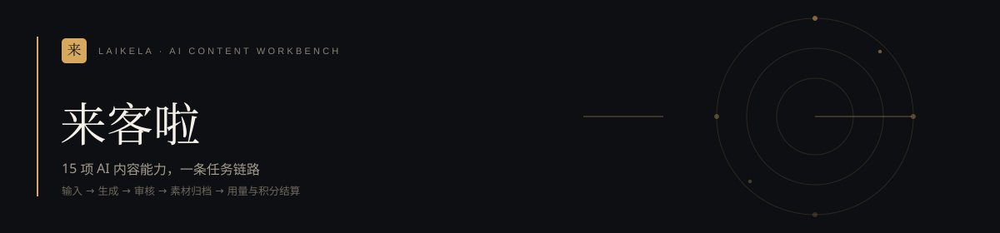

[](https://github.com/MathsionYang/Laikela)

### Content as Workflow ｜ 15 项 AI 内容能力，一条任务链路，从输入到积分结算


[**快速开始**](#-三分钟跑起来) · [**能力总览**](#-15-项能力总览) · [**核心设计**](#-核心设计) · [**积分账本**](#积分账本) · [**模型接入**](#-模型接入三条路径) · [**接口清单**](#-接口清单) · [**已知边界**](#-已知边界) · [**许可**](#-license)

---

## ⚡️ 来客啦是什么

面向中小商家的一站式 AI 内容生产台。把「想发什么」变成「已经发出去」，中间所有环节收进一条可追踪的任务链路。

不是聊天框套壳。差别在三个地方：

- **能力是结构化表单，不是自由提示词。** 15 个工具各自定义输入字段（品类、卖点、平台、时长、音色、色板…），提示词由系统按 schema 拼装，输出是可编辑的 Block 数组，不是一段散装文本。
- **任务是状态机，不是一次请求。** 长任务（混剪 300 秒、口播数字人 90 秒）进队列，前端靠 SSE 看实时阶段，刷新页面不丢进度，失败自动退积分。
- **模型是可插拔的路由目标，不是写死的 SDK。** 内置 10 个模型 + 任意 OpenAI 兼容端点；同一把 Key 覆盖文本/图像/视频/语音；平台配 Key、租户带 Key、用户自建端点三种模式共存，互不干扰。

技术栈对齐 `神秘力量_AI内容营销专家_功能复刻分析.md`，UI 视觉基准为 `../prototype-v2.html`（墨金编辑风：衬线标题 + 等宽编号 + 单一金色强调）。

---

## 🚀 三分钟跑起来

```bash
# 1) 基础设施（PostgreSQL 16 + Redis 7）
docker compose up -d

# 2) 依赖
npm install

# 3) 环境变量（复制后按需修改）
cp .env.example .env

# 4) 开发：Web + Worker 一起起
npm run dev:all
#    或分开：npm run dev（Web） / npm run worker（队列消费者）

# 5) 生产
npm run build && npm start
```

打开 <http://localhost:3000> ，用演示账号登录：

| 账号 | 口令 | 角色 | 初始状态 |
| --- | --- | --- | --- |
| `owner@laikela.local` | `laikela2026` | owner（空间管理员） | studio 套餐 · 22,000 积分/月 |

> **没装 Docker 也能跑。** `DB_DRIVER=auto` 先探 PostgreSQL，连不上自动降级 PGlite（嵌入式 Postgres/WASM）；
> `QUEUE_DRIVER=auto` 同理，Redis 不可用时切进程内队列。功能完全一致，只是不适合多实例部署。
> 想确认当前跑在哪套驱动上：`npm run doctor`，或 `GET /api/health`。

常见启动问题：

| 现象 | 原因 | 处理 |
| --- | --- | --- |
| `登录成功却立刻掉线` | http 环境下 `COOKIE_SECURE=1`，cookie 不回传 | 本机改成注释或 `0`，上了 HTTPS 再打开 |
| 改了 `.env` 里的 Key 但没生效 | Key 在模块加载时读入 | 重启进程；BYOK 与自定义端点则即时生效 |
| 任务卡在 `queued` 不动 | 没起 Worker | `npm run worker`，或用 `npm run dev:all` |

---

## 📦 15 项能力总览

积分与耗时来自 `src/lib/domain/tools.ts` 的真实定义。下表是**本地引擎 / 最便宜模型**下的扣分；
换云端模型会按模型单价实时变价，完整推导见 [`docs/PRICING.md`](docs/PRICING.md)。

### 📝 文案 · 1–2 积分

| 能力 | 输入要点 | 产出 | 耗时 | 积分 |
| --- | --- | --- | --- | --- |
| **智能文案** `copy-smart` | 一个想法 / 主题 | 标题、卖点、正文、CTA | 20s | 1 |
| **产品文案** `copy-product` | 产品参数、目标人群 | 用户听得懂的卖点转译 | 25s | 1 |
| **爆款选题** `copy-topic` | 赛道 + 平台 + 热点 | 可执行的选题清单 | 30s | 1 |
| **人设文案** `copy-persona` | 账号语气、价值观 | 可复用的写作人格 | 20s | 1 |

### 🖼️ 视觉 · 3 积分

| 能力 | 输入要点 | 产出 | 耗时 | 积分 |
| --- | --- | --- | --- | --- |
| **灵感成画** `image-gen` | 描述 + 参考图 + 风格 | 一组有方向的视觉素材 | 40s | 3 |
| **海报设计** `image-poster` | 主题、标题、时间、色板 | 直出可发布的社媒海报 | 35s | 3 |
| **网感封面** `growth-cover` | 关键帧 + 文案 + 风格 | 高点击率封面候选 | 40s | 3 |

> 海报与封面的文字由**真实字体渲染**（sharp + SVG），不是模型画的字。中文字形不糊、不编造笔画，代价是不支持手写体类特殊字效。

### 🎬 视频 · 6–9 积分

| 能力 | 输入要点 | 产出 | 耗时 | 积分 |
| --- | --- | --- | --- | --- |
| **一键大片** `video-movie` | 素材 / 主题 + 时长 + 节奏 | 节奏、转场、字幕、配乐成片 | 180s | 6 |
| **超级混剪** `video-mix` | 多套开头 × BGM × 字幕 | 批量组合出片 | 300s | 9 |
| **门店引流** `video-store` | 门店、团购套餐、活动 | 到店宣传视频 | 120s | 6 |
| **口播数字人** `avatar-talking` | 文案 + 形象 + 音色 | 真人口播，无需出镜 | 90s | 7 |
| **网感视频** `avatar-net` | 素材 + 平台 | 花字、贴纸、弹幕、热门音效 | 120s | 7 |

### 🎙️ 音频 · 1 积分

| 能力 | 输入要点 | 产出 | 耗时 | 积分 |
| --- | --- | --- | --- | --- |
| **音频合成** `audio-tts` | 文案 + 音色 + 语速 + BGM | 配音/BGM/音效对齐后的音轨 | 25s | 1 |

### 📈 增长 · 1–2 积分

| 能力 | 输入要点 | 产出 | 耗时 | 积分 |
| --- | --- | --- | --- | --- |
| **一键追爆** `growth-trend` | 赛道 + 平台 | 正在上涨的话题 → 跟进内容 | 30s | 1 |
| **视频反推** `growth-reverse` | 一条爆款视频 | 可复用的结构与分镜 | 40s | 2 |

---

## 🧠 核心设计

### 任务状态机

```
queued → running → post_processing → reviewing → succeeded
```

任一阶段失败进入 `failed`，任一阶段收到取消请求进入 `canceled`，**两条路都触发自动退款**（幂等，不会重复退）。

- 进度双通道：SSE（`/api/jobs/[id]/events`）推实时阶段 + 轮询兜底。SSE 断了页面不会永久卡住。
- 任务创建时就把选定的 `model_key` 落到 `jobs` 表，执行时再校验一次套餐（可能中途到期）。
- Worker 双实现：BullMQ（Redis）/ 进程内队列（降级），同一套 `pipeline.ts` 消费。

### 积分账本

**余额不存字段，只存流水。** `balance = sum(delta)`，避免「余额字段」和「流水明细」对不上这个经典问题。

| 设计点 | 做法 | 解决什么 |
| --- | --- | --- |
| 并发安全 | `pg_advisory_xact_lock(hashtext(org_id))` 串行化同租户 | 两个请求同时扣，余额扣成负数 |
| 幂等 | `idempotency_key` 唯一索引：`job:<id>:consume` / `job:<id>:refund` | 回调重放、用户重复点、网络重试导致重复扣 |
| 月度发放 | `grant:<org>:<自然月>` | 反复升降级刷额度（每换一次套餐就发一次） |
| 退款额度 | 取该 job 的 consume 绝对值；无扣减则 `applied:false` | 没扣过钱的任务「退款」凭空造出积分 |

计费口径（完整推导见 [`docs/PRICING.md`](docs/PRICING.md)）：

```
token 层：价格 = 模型官方成本 × (1 + 套餐服务费率)
  平台代付 Key        → ceil(成本 × (1 + 费率))   费率 5% / 4.5% / 4% / 3%
  自带 Key / 自定义端点 → ceil(成本 × 费率)         模型费用户直接付给厂商
  最低扣分            → 1 积分（低于 1 分钱的交易财务上不可结算）

套餐层：月费 = token 成本 + 固定成本（¥19.2/月）+ 利润
  额度上限 = (月费 × 0.8 − 固定成本) ÷ 最坏每积分成本(0.957 分)
  创作版 6,000 / 工作室 22,000 / 企业版 95,000 —— 额度用满也不亏
```

成本取供应商官方牌价（DeepSeek V4 Flash 输入 1 元 / 输出 2 元每百万 token，豆包 Seed 2.1 Pro 6 / 30 元），
`unitPrice` 写在 `src/lib/ai/catalog.ts`，费率写在 `src/lib/domain/pricing.ts`，两边都可独立调。
**压力测试结论：三档套餐在「额度 100% 用满 + 全选最贵模型」下净利率 22%–23%。**

失败 / 取消 → 全额退回，幂等。

### 订阅

四档套餐（`free` / `creator` / `studio` / `enterprise`），表结构 `plans × subscriptions × orders`。

- `subscriptions(org_id) WHERE status='active'` 建**部分唯一索引**，数据库层面保证一个租户只有一条生效订阅，不靠应用层自觉。
- 积分按自然月发放，中途换套餐当月不重复发（提示语会明确告知「本月额度已发放过，下月按新套餐发放」）。
- 取消续订 = `cancel_at_period_end`，当期不退款、到期不扣费；可恢复。

---

## 🔐 模型接入：三条路径

这是本项目最需要说清楚的部分。**越靠下越即时生效**：

| 层级 | 配置位置 | 谁付费 | 生效方式 | 适用场景 |
| --- | --- | --- | --- | --- |
| ① 平台托管 Key | `.env` 的 `DEEPSEEK_API_KEY` / `DOUBAO_API_KEY` | 平台 | 重启进程 | 自己运营，所有租户共用 |
| ② 租户 BYOK | 登录后 `/settings/models` → 供应商凭证 | 用户 | 即时 | 让客户带自己的厂商 Key |
| ③ 自定义端点 | `/settings/models` → 接入任意兼容模型 | 用户 | 即时 | 自建 vLLM / Ollama、中转站、Azure… |

### ① 平台托管 Key（内置模型的 Key 配在哪）

改 `.env`：

```ini
# DeepSeek：文本主力
DEEPSEEK_API_KEY=sk-xxxxxxxxxxxxxxxx
DEEPSEEK_BASE_URL=https://api.deepseek.com
DEEPSEEK_MODEL=deepseek-chat

# 豆包 · 火山方舟：同时驱动文本 / Image 2.5 / Seedance 2.5 / 语音
DOUBAO_API_KEY=xxxxxxxx-xxxx-xxxx
DOUBAO_BASE_URL=https://ark.cn-beijing.volces.com/api/v3
DOUBAO_MODEL=doubao-pro-32k
```

- 改完**必须重启**（`npm start` / `npm run dev`），Key 在模块加载时读入。
- **一个 Key 覆盖该厂商全部模型**：豆包那把同时给 `doubao-pro-32k`、`doubao-image-2.5`、`doubao-seedance-2.5`、`doubao-tts` 用。
- 不配也能跑：路由自动落到本地引擎（规则文案 / 字体排版 / 分镜渲染 / 音轨合成），产出结构完全一致。
- `CREDENTIAL_SECRET` 是加密 BYOK 与端点 Key 的主密钥，不配则用 `SIGNING_SECRET` 派生；**一旦库里有历史凭证就不要再换**，否则旧密文解不开。

### ② 租户 BYOK（同一厂商换自己的钥匙）

`/settings/models` → 「供应商凭证」→ 粘贴 Key → 保存。

- 只存密文：AES-256-GCM（`v1:<iv>:<tag>:<data>`），前端永远只看到 `sk-••••7890` 掩码。
- 优先级 **BYOK > 平台 Key**，填了就走自己的额度。
- **解密失败不静默回落**到平台 Key —— 否则用户以为在用自己的 Key，实际被平台计费。
- 一次调用失败只标 `last_error`，不停用；下次成功自动清除。

### ③ 自定义端点（任意 OpenAI 协议兼容服务）

`/settings/models` → 「接入任意兼容模型」，填三个值：

```
Base URL   https://api.siliconflow.cn/v1      # 一般以 /v1 结尾，末尾不要写 /chat/completions
模型名称   Qwen/Qwen2.5-72B-Instruct          # 服务端真实 model id，不是展示名
API Key    sk-xxxxxx
```

- 判据只有一条：服务实现 `POST {base_url}/chat/completions` 且用 `Authorization: Bearer`。OpenAI、DeepSeek、硅基流动、月之暗面、通义、vLLM、Ollama、one-api / new-api 中转站全部适用。
- 出图类服务选「图像」类型，按 `POST {base_url}/images/generations` 调用。
- 「测试连接」真发一次 `max_tokens=16` 的请求，并对 404 / 401 / model 不存在分别给排查提示 —— 兼容层的坑基本就在「baseURL 要不要带 `/v1`」和「模型名对不对」。
- 保存后立刻出现在生成页的「生成模型」下拉里，和内置模型共用同一套路由、计费、降级逻辑。

### 模型目录与权限

模型清单在 `src/lib/ai/catalog.ts`（**代码即真相**，跟着版本走），运行时开关在 `model_catalog` 表（只存开关 / 优先级 / 积分覆盖，不存模型定义）。

| 概念 | 说明 |
| --- | --- |
| `requiresPlan` | 最低套餐要求（free < creator < studio < enterprise） |
| `byokOnly` | 平台不代付，必须自带 Key（如 Seedance 2.5 按秒计费，防误烧） |
| `fallback` | 平台不可用时的降级目标 |
| `credits` | 平台代付时该模型的积分（可在库里覆盖） |
| `protocol` | `openai-chat` / `ark-image` / `ark-video` / `ark-tts` / `local` |

**路由顺序**：显式偏好 → 能力匹配 → 目录优先级 → 降级链 → 本地兜底。

本地模型永远排最后，保证任何配置问题都不会让任务跑不出来 —— 云端 Key 失效时任务仍能 succeeded，只是 `output.degraded` 会说明用了哪个兜底。

---

## 📖 目录结构

```
Browser / 小程序
      │  Cookie 会话 · TanStack Query 轮询 + SSE
      ▼
Next.js App Router  ──  9 个页面 · 24 个接口 · SSE 进度
      │
      ├─ lib/jobs      状态机 / 队列(redis|memory) / 流水线 / 自动退款
      ├─ lib/ai        目录 / 路由 / 协议适配 / BYOK 加解密 / 自定义端点
      ├─ lib/gateway   文案编排 + JSON 校验 + 重试 + 本地兜底
      ├─ lib/billing   套餐 / 订阅 / 订单
      ├─ lib/credits   账本 / 幂等 / 并发锁
      ├─ lib/media     海报 / 封面 / 分镜 / 音频（sharp + SVG）
      ├─ lib/db        postgres | pglite（双驱动同一套 SQL）
      └─ lib/storage   local | s3
```

```
src/
├── app/
│   ├── (console)/            总览 / 工具 / 素材库 / 增长 / 订阅 / 模型接入 / 管理台
│   ├── login/                登录与注册
│   └── api/                  REST + SSE
├── components/               Shell、工作台、结果渲染
└── lib/                      见上方分层
worker/index.ts               BullMQ 消费者入口
```

---

## 🔌 接口清单

| 方法 | 路径 | 说明 |
| --- | --- | --- |
| POST | `/api/auth/login` · `/register` · `/logout` | 认证 |
| GET | `/api/auth/me` | 当前用户 + 组织 + 套餐 + 积分 |
| GET | `/api/tools` | 工具目录 + 运行统计 |
| POST | `/api/jobs` | 创建任务 `{tool, input, modelKey?}`，返回选定模型与扣费结果 |
| GET | `/api/jobs/[id]` · `/events` | 任务详情 / SSE 进度 |
| POST | `/api/jobs/[id]/cancel` | 取消并退款 |
| GET | `/api/models` | 模型目录 + 可用性 + Key 来源 + 已接端点 |
| PATCH | `/api/models` | 运行时启停某个模型 |
| GET/POST/DELETE | `/api/models/keys` | BYOK 读写删 |
| GET/POST/PATCH/DELETE | `/api/models/endpoints` | 自定义端点管理 |
| POST | `/api/models/endpoints/test` | 真打一次最小请求验证连通性 |
| GET/POST/PATCH | `/api/billing` | 订阅概览 / 开通 / 取消与恢复 |
| GET | `/api/assets` · `/dashboard` · `/usage` | 素材 / 总览 / 用量 |
| GET | `/api/health` | 数据库与队列驱动、连通性 |

`/api/jobs` 的错误码：`INSUFFICIENT_CREDITS`(402) / `INVALID_INPUT`(422) / `NO_TOOL`(404) / `UNAUTHORIZED`(401)。

---

## 📄 已知边界

诚实列出，避免接手的人踩空：

- **支付是演示通道。** `channel=mock`，点开通即写 `paid`。接微信支付要拆成「下单 → 回调验签 → 幂等激活」两阶段交割，当前 `startSubscription()` 是单事务一把梭，需重构。个人主体接入的可行性、主体门槛与通道选型见 [`docs/PAYMENT-ACCESS.md`](docs/PAYMENT-ACCESS.md)。
- **真实云端模型未联调。** 本地引擎与 mock OpenAI 端点已端到端验证；真实 DeepSeek / 豆包 Key 未配置，故 401/429/5xx 映射、Seedance 异步任务轮询、TTS 真实音色均未在真实厂商环境验证。
- **视频不做本地 mp4 编码。** 本机无 FFmpeg，输出为「分镜关键帧 + `timeline.json` 时间轴 + 云端成片（Seedance 可用时）」。
- **自定义端点只支持 `text` 与 `image`。** `video` / `audio` 需厂商专有协议，走内置目录。
- **无邮箱验证、无找回密码。** 会话有效期 7 天，过期需重新登录。
- **无成员邀请与角色管理 UI。** `owner` / `admin` / `member` 角色枚举已存在，只有 owner 能改模型凭证。
- **`next dev` 下 React hydration 有 HMR 握手问题**（Turbopack websocket），`next start` 正常，不影响交付。
- **无单元测试与 CI。** 验证方式是端到端探针脚本，未沉淀成测试用例。

---

## 📜 License

本项目基于 [MIT License](LICENSE) 开源发布，Copyright (c) 2026 [MathsionYang](https://github.com/MathsionYang)。

简单说：你可以自由使用、修改、分发、商用，也可以闭源二次开发，只需在副本中保留版权声明与许可声明。软件按「现状」提供，不含任何担保。

> **注意**：MIT 覆盖的是本仓库的代码。通过本项目调用的第三方模型（DeepSeek、豆包、Seedream、Seedance 等）仍受各自厂商的服务条款与内容合规要求约束；模型输出的内容版权归属，请以对应厂商协议为准。

---

<div align="center">
<sub>如果这个项目对你有帮助，欢迎点个 Star。</sub>
</div>
