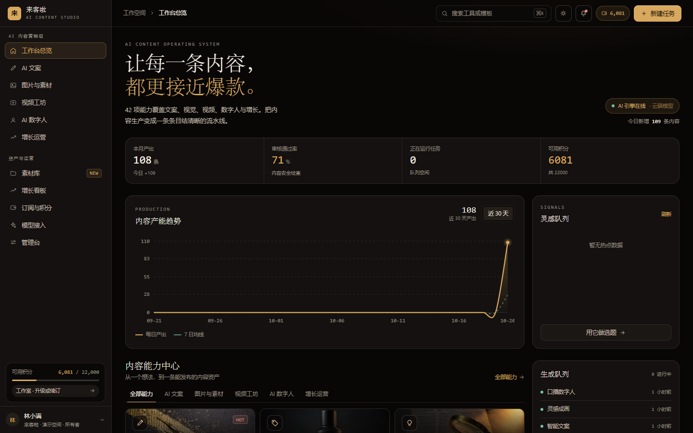
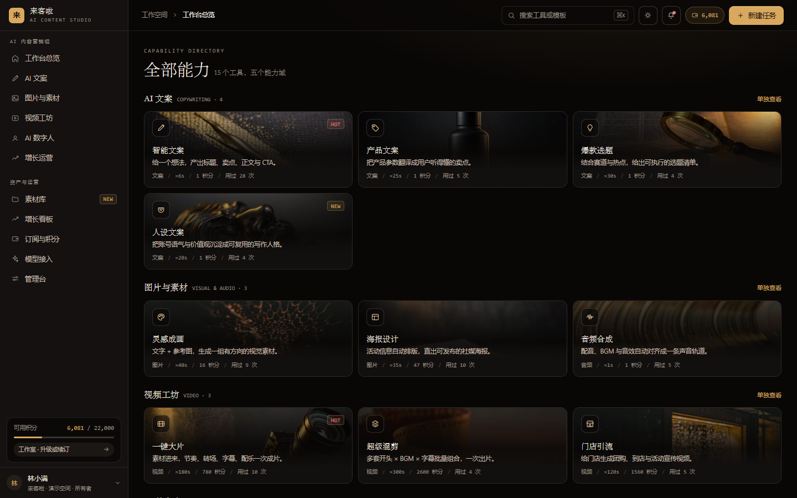
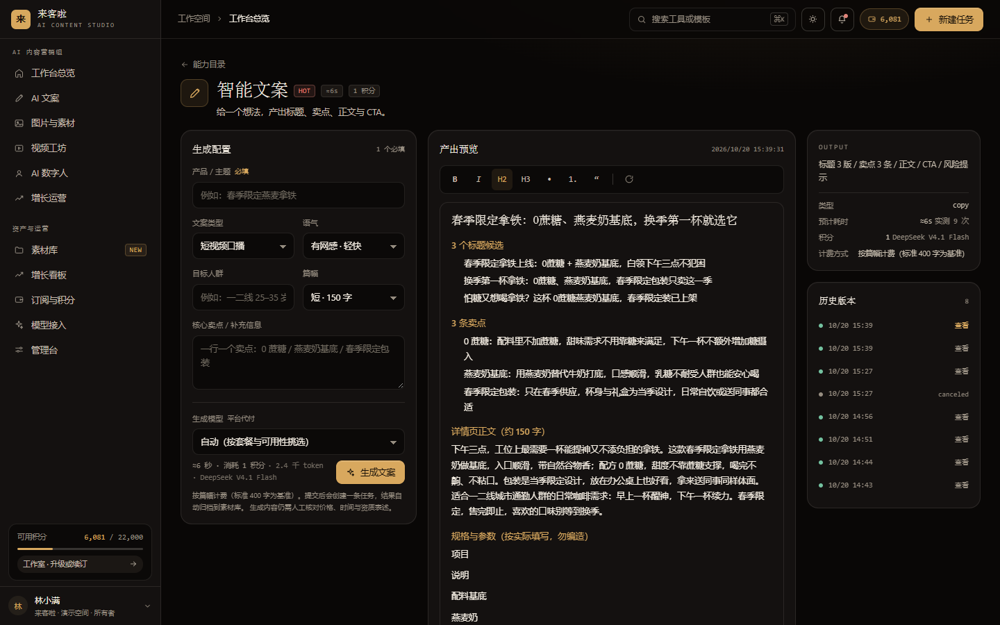
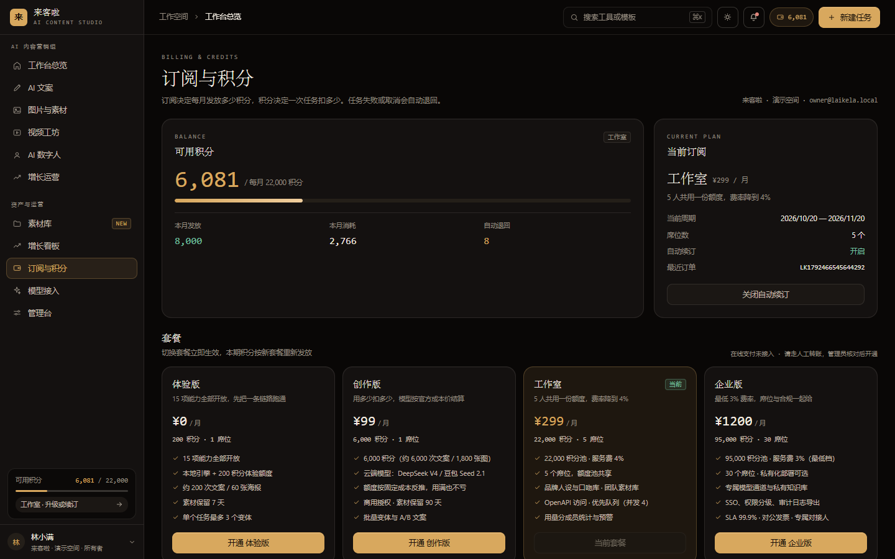
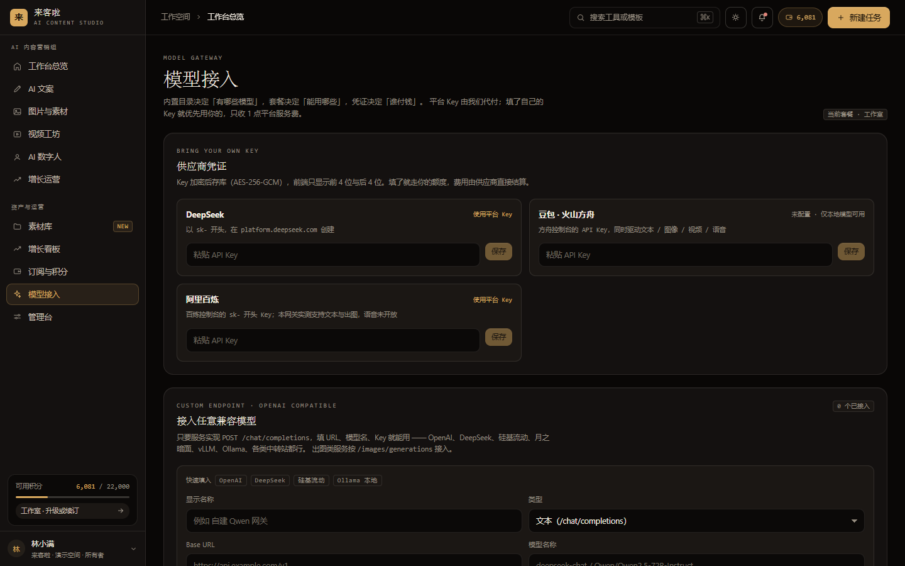
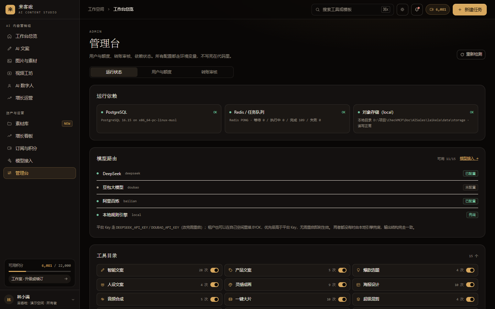
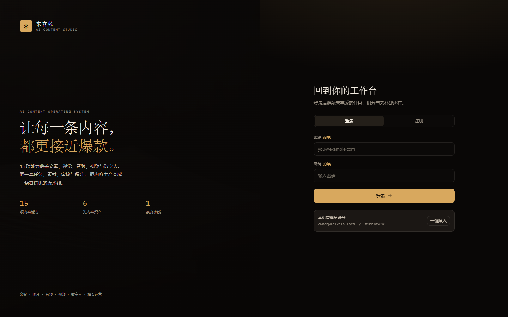

[](https://github.com/MathsionYang/Laikela)

### Content as Workflow ｜ 15 项 AI 内容能力，一条任务链路，从输入到积分结算


[**快速开始**](#-三分钟跑起来) · [**能力总览**](#-15-项能力总览) · [**核心设计**](#-核心设计) · [**积分账本**](#积分账本) · [**账号与充值**](#-账号额度与充值) · [**模型接入**](#-模型接入三条路径) · [**接口清单**](#-接口清单) · [**已知边界**](#-已知边界) · [**许可**](#-license)

---

## ⚡️ 来客啦是什么

面向中小商家的一站式 AI 内容生产台。把「想发什么」变成「已经发出去」，中间所有环节收进一条可追踪的任务链路。

不是聊天框套壳。差别在三个地方：

- **能力是结构化表单，不是自由提示词。** 15 个工具各自定义输入字段（品类、卖点、平台、时长、音色、色板…），提示词由系统按 schema 拼装，输出是可编辑的 Block 数组，不是一段散装文本。
- **任务是状态机，不是一次请求。** 长任务（混剪 300 秒、口播数字人 90 秒）进队列，前端靠 SSE 看实时阶段，刷新页面不丢进度，失败自动退积分。
- **模型是可插拔的路由目标，不是写死的 SDK。** 内置 10 个模型 + 任意 OpenAI 兼容端点；同一把 Key 覆盖文本/图像/视频/语音；平台配 Key、租户带 Key、用户自建端点三种模式共存，互不干扰。

技术栈对齐 `神秘力量_AI内容营销专家_功能复刻分析.md`，UI 视觉基准为 `../prototype-v2.html`（墨金编辑风：衬线标题 + 等宽编号 + 单一金色强调）。

---

## 🖼 界面预览

以下截图取自本地 `npm run serve` 的真实运行状态，**没有 mock 数据**：任务、素材、积分、成本都是这台机器上真跑出来的（1440×900）。

**工作台** —— 本月产出、审核通过率、正在跑的任务、剩余积分四张卡；下方是 30 天产能趋势与生成队列，左侧为六组导航。



**全部能力** —— 15 个工具按文案 / 图片 / 视频 / 数字人 / 增长五条产线归档，每个卡片直接标出预计耗时、扣多少积分、被用过几次。



**智能文案** —— 左边是结构化输入（品类、平台、时长、卖点），中间是 Block 编辑器里的真实产出，右边同一屏标出模型、用时、扣分与计费方式，以及可回看的历史版本。



**素材库** —— 文字、图片、音频、视频、分镜、时间轴七档分类；缩略图可预览、可下载、可删除，「全部」只列成品，分镜和中间产物收在各自分档里。


**订阅与积分** —— 当前余额、本月发放 / 消耗 / 自动退回，四档套餐的积分池、并发数、席位与费率差异一屏可比。



**模型接入** —— 平台 Key 与 BYOK 并存，Key 加密落库、前端只回显末四位；也支持填 Base URL + 模型名接任意 OpenAI 兼容端点。



**管理台** —— 依赖自检（PostgreSQL / Redis / 对象存储）、模型路由的可用与已配置状态、逐个工具的开关与用量。



**登录** —— 邮箱验证码注册，本机未配 SMTP 时验证码写到控制台，管理员账号可一键填入。



---

## 🚀 三分钟跑起来

```bash
# 1) 基础设施（PostgreSQL 16 + Redis 7）
docker compose up -d

# 2) 依赖
npm install

# 3) 环境变量（复制后按需修改）
cp .env.example .env

# 4) 开发：Web + Worker 一起起
npm run dev:all
#    或分开：npm run dev（Web） / npm run worker（队列消费者）

# 5) 生产
npm run build && npm start

# 6) 改过定价/计费量就跑一遍，规则不完整会以退出码 1 拦住你
npm run check:margin
```

### 一键启动（本地自测）

上面六步不想记，直接双击根目录的 **`start.bat`**（Windows）。它按顺序做这些事：

1. 查 Node 版本（< 20 直接拦住）与 `node_modules`，缺依赖自动 `npm install`
2. 拉起 PostgreSQL / Redis；**没装 Docker 就自动降级** PGlite + 进程内队列，不会启动失败
3. 检查端口占用（`--force` 才会杀进程，默认只提示）
4. 对比 `src/` 与 `.next/BUILD_ID` 的时间戳，**只有源码变了才重建**
5. 起服务，轮询 `/api/health`，打印依赖状态、可用模型通道与登录账号

```bash
npm run serve                  # 生产模式，端口 3000
npm run serve -- --dev         # 开发模式，跳过构建，改代码即时生效
npm run serve -- --port=3100   # 换端口
npm run serve -- --force       # 端口被旧进程占住时强制结束
npm run serve -- --no-docker   # 完全不碰 Docker
npm run serve -- --check       # 起来后再跑计费规则校验与模型连通性自检
```

按 `Ctrl+C` 停止，会连带结束 Next 子进程，不留孤儿进程。

打开 <http://localhost:3000> ，用管理员账号登录：

| 账号 | 口令 | 角色 | 初始状态 |
| --- | --- | --- | --- |
| `owner@laikela.local` | `laikela2026` | owner（空间管理员） | studio 套餐 · 22,000 积分/月 |

> **没装 Docker 也能跑。** `DB_DRIVER=auto` 先探 PostgreSQL，连不上自动降级 PGlite（嵌入式 Postgres/WASM）；
> `QUEUE_DRIVER=auto` 同理，Redis 不可用时切进程内队列。功能完全一致，只是不适合多实例部署。
> 想确认当前跑在哪套驱动上：`npm run doctor`，或 `GET /api/health`。

常见启动问题：

| 现象 | 原因 | 处理 |
| --- | --- | --- |
| `登录成功却立刻掉线` | http 环境下 `COOKIE_SECURE=1`，cookie 不回传 | 本机改成注释或 `0`，上了 HTTPS 再打开 |
| 改了 `.env` 里的 Key 但没生效 | Key 在模块加载时读入 | 重启进程；BYOK 与自定义端点则即时生效 |
| 任务卡在 `queued` 不动 | 没起 Worker | `npm run worker`，或用 `npm run dev:all` |
| 双击 `start.bat` 满屏 `'xxx' 不是内部或外部命令` 且带乱码 | 文件被存成含中文的 UTF-8/GBK，`chcp` 换代码页后 cmd 按旧字节偏移切行 | `start.bat` 必须**纯 ASCII + CRLF**（已由 `.gitattributes` 强制）；中文只放在 Node 的输出里 |

---

## 📦 15 项能力总览

表里的**积分是本地引擎下的实际扣分**，跑云端模型会按所选模型实时变价；
**耗时是基线估值**，实际卡片会显示近 90 天同档引擎的实测中位数。

计费量按实际产出算 —— 出 4 张扣 4 张、出 60 秒扣 60 秒、文案越长扣越多。
卡片价、配置页预览价、提交时的扣费三处共用同一个函数 `quoteCost()`，不存在两套数字。

### 📝 文案 · 1 积分起

| 能力 | 输入要点 | 产出 | 耗时 | 积分 |
| --- | --- | --- | --- | --- |
| **智能文案** `copy-smart` | 一个想法 / 主题 | 标题、卖点、正文、CTA | 20s | 1 |
| **产品文案** `copy-product` | 产品参数、目标人群 | 用户听得懂的卖点转译 | 25s | 1 |
| **爆款选题** `copy-topic` | 赛道 + 平台 + 热点 | 可执行的选题清单 | 30s | 1 |
| **人设文案** `copy-persona` | 账号语气、价值观 | 可复用的写作人格 | 20s | 1 |

### 🖼️ 视觉 · 3–7 积分（按张计费）

| 能力 | 输入要点 | 产出 | 耗时 | 积分 |
| --- | --- | --- | --- | --- |
| **灵感成画** `image-gen` | 描述 + 参考图 + 风格 | 一组有方向的视觉素材 | 40s | 3 起（按张） |
| **海报设计** `image-poster` | 主题、标题、时间、色板 | 直出可发布的社媒海报 | 35s | 7（3 张） |
| **网感封面** `growth-cover` | 关键帧 + 文案 + 风格 | 高点击率封面候选 | 40s | 7 起（按张） |

> 海报与封面的文字由**真实字体渲染**（sharp + SVG），不是模型画的字。中文字形不糊、不编造笔画，代价是不支持手写体类特殊字效。

### 🎬 视频 · 16–53 积分（按秒计费）

| 能力 | 输入要点 | 产出 | 耗时 | 积分 |
| --- | --- | --- | --- | --- |
| **一键大片** `video-movie` | 素材 / 主题 + 时长 + 节奏 | 节奏、转场、字幕、配乐成片 | 180s | 16（15 秒） |
| **超级混剪** `video-mix` | 多套开头 × BGM × 字幕 | 批量组合出片 | 300s | 53（50 秒） |
| **门店引流** `video-store` | 门店、团购套餐、活动 | 到店宣传视频 | 120s | 32（30 秒） |
| **口播数字人** `avatar-talking` | 文案 + 形象 + 音色 | 真人口播，无需出镜 | 90s | 16 起（按字数折秒） |
| **网感视频** `avatar-net` | 素材 + 平台 | 花字、贴纸、弹幕、热门音效 | 120s | 21（20 秒） |

### 🎙️ 音频 · 1 积分

| 能力 | 输入要点 | 产出 | 耗时 | 积分 |
| --- | --- | --- | --- | --- |
| **音频合成** `audio-tts` | 文案 + 音色 + 语速 + BGM | 配音/BGM/音效对齐后的音轨 | 25s | 1 起（按千字符） |

### 📈 增长 · 1 积分起

| 能力 | 输入要点 | 产出 | 耗时 | 积分 |
| --- | --- | --- | --- | --- |
| **一键追爆** `growth-trend` | 赛道 + 平台 | 正在上涨的话题 → 跟进内容 | 30s | 1 起（按条数） |
| **视频反推** `growth-reverse` | 一条爆款视频 | 可复用的结构与分镜 | 40s | 1 |

---

## 🧠 核心设计

### 任务状态机

```
queued → running → post_processing → reviewing → succeeded
```

任一阶段失败进入 `failed`，任一阶段收到取消请求进入 `canceled`，**两条路都触发自动退款**（幂等，不会重复退）。

- 进度双通道：SSE（`/api/jobs/[id]/events`）推实时阶段 + 轮询兜底。SSE 断了页面不会永久卡住。
- 任务创建时就把选定的 `model_key` 落到 `jobs` 表，执行时再校验一次套餐（可能中途到期）。
- Worker 双实现：BullMQ（Redis）/ 进程内队列（降级），同一套 `pipeline.ts` 消费。

### 积分账本

**余额不存字段，只存流水。** `balance = sum(delta)`，避免「余额字段」和「流水明细」对不上这个经典问题。

| 设计点 | 做法 | 解决什么 |
| --- | --- | --- |
| 并发安全 | `pg_advisory_xact_lock(hashtext(org_id))` 串行化同租户 | 两个请求同时扣，余额扣成负数 |
| 幂等 | `idempotency_key` 唯一索引：`job:<id>:consume` / `job:<id>:refund` | 回调重放、用户重复点、网络重试导致重复扣 |
| 月度发放 | `grant:<org>:<自然月>` | 反复升降级刷额度（每换一次套餐就发一次） |
| 退款额度 | 取该 job 的 consume 绝对值；无扣减则 `applied:false` | 没扣过钱的任务「退款」凭空造出积分 |

计费规则的**单一事实来源**是 `src/lib/domain/pricing.ts`：计费量由 `ToolDef.billing` 按实际产出换算（出图按张、出片按秒、配音按千字符、文案按篇幅档位），
卡片报价、配置页预览价与提交扣费共用同一个 `quoteCost()`，不存在「界面一套数字、扣费另一套」的情况。

失败 / 取消 → 全额退回，幂等。

### 订阅

四档套餐（`free` / `creator` / `studio` / `enterprise`），表结构 `plans × subscriptions × orders`。

- `subscriptions(org_id) WHERE status='active'` 建**部分唯一索引**，数据库层面保证一个租户只有一条生效订阅，不靠应用层自觉。
- 积分按自然月发放，中途换套餐当月不重复发（提示语会明确告知「本月额度已发放过，下月按新套餐发放」）。
- 取消续订 = `cancel_at_period_end`，当期不退款、到期不扣费；可恢复。

---

## 🗂 素材：保存、预览、下载、删除

任务产出的四类内容全部落盘，素材库是它们唯一的入口 —— 不是「生成完就散在任务详情里」。

| 产出 | 落盘文件 | 计费单位 | 素材形态 |
| --- | --- | --- | --- |
| 文案 | `final.md`（标题 + 正文，utf-8） | 千 token | 卡片显示正文摘要，点开看全文 |
| 图片 | `final-1..n.png` + `thumb-1..n.webp` | 张 | 缩略图 240px，点开看原图 |
| 音频 | `mix.wav` / `mix.mp3` | 千字符 | 原生播放器 |
| 视频 | `final.mp4`（云端）/ `shot-*.png` + `timeline.json`（本地分镜） | 秒 | 原生播放器 / 分镜关键帧 |

- **存储位置**：默认 `./data/storage/{orgId}/jobs/{jobId}/…`（`STORAGE_DRIVER=local`，零额外依赖）；改成 `s3` 后同一套 key 结构进桶，代码不用动。
- **下载走 `/api/assets/[id]/download`**，不是签名 URL。签名 URL 里只有存储 key（`final-1.png`），落地文件名会变成这串机器名；这个口子会带上素材名并做 RFC 5987 编码，中文文件名不乱码。
- **删除是真删**：先删存储文件（含缩略图、`asset_versions` 里的历史版本），再删数据库行。只删行不删文件，本地目录会越攒越大且再也无法回收。界面上点垃圾桶会弹确认框（列出素材名与大小），不再用「再点一次」的短暂时窗 —— 那个设计会让人以为点了没反应。文件被占用（Windows 上正在播放的视频）时记录会照删、日志留 `[assets] 文件回收失败` 并带出 key，提示里的「回收 N 个文件」只统计真删掉的，不虚报。
- **编辑同步**：在文案编辑器里改完保存，素材库那份 `.md` 会一起更新 —— 否则用户下载到的是第一次生成的旧稿。
- **缩略图单独一行**：`role='thumbnail'` 的素材不占列表位置，只作为图片/视频的 `thumbUrl`；素材多的账号不会因为拖 1080px 原图而吃掉几百 MB 流量。
- **列表只列成品**：默认视图是 `role in (final, original)`，即每个任务真正交付的东西。分镜关键帧（`proxy`）与 `timeline.json`（`metadata`）属于任务的中间产物，翻到「分镜」「文件」分档才出现 —— 否则一个视频任务就会往首屏塞 6 张几乎一样的画面。
- **重复素材清理**：`npm run assets:dedupe` 预演，`npm run assets:dedupe -- --apply` 执行。规则是同 `kind` 同名的只留最新一条，缩略图跟随父素材；执行前把「留什么、删什么」全量写进 `data/backup/dedupe-assets-<时间戳>.json`，可人工回滚。
- **孤儿文件回收**：`npm run assets:gc` 扫「磁盘有、库里没引用」的文件，`--apply` 真删。文件删除失败（被占用、宿主钩子拦截）时记录会照删、文件留在盘上，这个命令负责把它们收回来。

### 计费与素材是同一条链路

卡片上的「x 积分 / y 秒」不是手写常量：`/api/tools` 用**和下单同一套** `resolveModel + quoteCost` 现算，耗时取近 90 天成功任务的实测中位数（本地/云端分桶，剔除演示与降级样本）。

两个容易出错的点已经修掉：

- **失效 Key 不再被自动选中。** 上次调用 401 的 Key 依然可用（不做永久封禁），但自动路由会把它排到本地引擎后面 —— 否则卡片写着「豆包 · 20 秒」，跑起来却掉回本地，报价和实际执行是两张皮。
- **降级按实际引擎重新结账。** 云端失败回落本地后，`output.billing` 记录 `charged / actual / refunded`，多收的积分自动退回（只退不补：事后加价等于暗改价格）。

---


### 注册必须先过邮箱验证

注册接口 `POST /api/auth/register` **只建账号、不发会话**，同时下发一封 6 位验证码邮件；`POST /api/auth/verify-email` 校验通过后才 `createSession`。未验证账号去登录，会拿到 `403 EMAIL_UNVERIFIED`，前端直接切到验证面板并自动补发一封。

几个刻意的选择：

- **用验证码，不用魔法链接。** 很多企业邮箱会预取邮件里的链接，一点就「帮别人验证了账号」；验证码没有这个问题，也不依赖公网域名可达。
- **库里只存 HMAC 摘要。** 6 位数字空间只有 100 万，裸 sha256 离线可爆破，所以存 `HMAC-SHA256(serverSecret, userId:code)`。
- **冷却与配额落库，不依赖 Redis。** 60 秒重发冷却、每小时 6 封上限、5 次错误即作废、15 分钟过期；旧码在发新码时立即作废，只认最新一封。
- **没配 SMTP 也能跑通。** 走 `outbox` 驱动：正文落 `mail_outbox` 表并打到控制台；本机 `MAIL_DEBUG_CODE=1` 时接口会把码回传，生产环境即使忘了配 SMTP 也不会泄漏。
- **存量账号不会被锁在门外。** 迁移给上线前的账号统一回填 `email_verified_at`（用 `app_settings` 打标记，只跑一次）。

### 平台管理员：跨租户，与租户角色分开

`users.is_admin` 才是平台管理员，和租户内的 `role`（owner/admin/member）不是一套东西。提权两条路：直接改库，或配 `ADMIN_EMAILS=a@x.com,b@y.com`（启动时自动提升，天然幂等）。演示账号 `owner@laikela.local` 默认就是管理员。

`/admin` 页面分三档：

| 分区 | 能做什么 |
| --- | --- |
| 运行状态 | 依赖探测、模型路由、工具目录、本月用量 |
| 用户与额度 | 搜用户 → 直接调积分（±）、改套餐（含附加积分）、看余额/本月消耗/验证状态 |
| 转账审核 | 待审转账单，通过时选套餐 + 补积分，驳回留原因 |

每个动作都写 `admin_audit_log`：谁、对哪个租户、改了什么、为什么。

### 人工转账：拿到商户号之前的正式通道

个人主体拿不到微信/支付宝的收款 API（资质门槛所致），所以这条链路是**现在的正式通道**，不是临时补丁：

```
用户在 /billing 看到收款信息 → 转账 → 提交金额/单号/付款人
        ↓  manual_payments(status=pending)
管理员在 /admin 转账审核里核对流水 → 通过（选套餐 + 补积分）/ 驳回
        ↓  条件更新 where status='pending'
发放积分（幂等键 manual:<单号>:bonus）+ 变更订阅 + 写审计
```

防呆设计：同一笔转账单号不允许重复申报；单租户最多 3 笔待审；审核用条件更新，两个人同时点「通过」也只会发一次；发放用带单号的幂等键，重试不会重复入账。

---

## 🔐 模型接入：三条路径

这是本项目最需要说清楚的部分。**越靠下越即时生效**：

| 层级 | 配置位置 | 谁付费 | 生效方式 | 适用场景 |
| --- | --- | --- | --- | --- |
| ① 平台托管 Key | `.env` 的 `DEEPSEEK_API_KEY` / `DOUBAO_API_KEY` / `BAILIAN_API_KEY` | 平台 | 重启进程 | 自己运营，所有租户共用 |
| ② 租户 BYOK | 登录后 `/settings/models` → 供应商凭证 | 用户 | 即时 | 让客户带自己的厂商 Key |
| ③ 自定义端点 | `/settings/models` → 接入任意兼容模型 | 用户 | 即时 | 自建 vLLM / Ollama、中转站、Azure… |

### ① 平台托管 Key（内置模型的 Key 配在哪）

改 `.env`：

```ini
# DeepSeek：文本主力（当前线上配置）
DEEPSEEK_API_KEY=sk-xxxxxxxxxxxxxxxx
DEEPSEEK_BASE_URL=https://api.deepseek.com
DEEPSEEK_MODEL=deepseek-flash          # 必须是 GET /models 返回的 id，不是展示名

# 豆包 · 火山方舟：同时驱动文本 / Image 2.5 / Seedance 2.5 / 语音
DOUBAO_API_KEY=xxxxxxxx-xxxx-xxxx
DOUBAO_BASE_URL=https://ark.cn-beijing.volces.com/api/v3
DOUBAO_MODEL=doubao-pro-32k

# 阿里百炼（专属网关）：文本 / 出图 / 出片；语音未开放（见 docs/ALIYUN-BAILIAN-TEST.md）
BAILIAN_API_KEY=sk-ws-xxxxxxxx
BAILIAN_BASE_URL=https://ws-xxxxxxxx.cn-beijing.maas.aliyuncs.com/compatible-mode/v1
BAILIAN_TEXT_MODEL=qwen3.8-flash
BAILIAN_IMAGE_MODEL=qwen-image-2.1-turbo
```

**阿里百炼的四个坑**（都踩过，实测记录见 `docs/ALIYUN-BAILIAN-TEST.md`）：

| 坑 | 表现 | 处理 |
|---|---|---|
| 两套路径 | 文本/图像在 `/compatible-mode/v1`，视频在根路径 `/api/v1/...` | 适配层 `dashscopeHost()` 剥 host，不能拼同一个 baseUrl |
| 视频要异步头 | 不带 `X-DashScope-Async: enable` 直接 400 | 提交后轮询 `/api/v1/tasks/{id}`，5 秒任务约 3 分钟 |
| usage 两套字段 | 2.x 是 `width/height`，3.0 是 `output_width/output_height` | 尺寸以请求参数为准，usage 只做参考 |
| 语音不可用 | `/audio/*` 全 404，TTS 型号额度耗尽（403） | 语音继续走本地音轨合成 |

- 改完**必须重启**（`npm start` / `npm run dev`），Key 在模块加载时读入。
- 当前 DeepSeek 账号可用的模型 id 只有两个：`deepseek-flash`（V4.1 Flash，1M 上下文）和 `deepseek-v4-pro`。
  目录里的 `deepseek-chat` / `deepseek-reasoner` 是**内部 key**，发给供应商的 `model` 字段由 `src/lib/ai/model-name.ts` 决定：前者跟 `DEEPSEEK_MODEL`，后者固定 `deepseek-v4-pro`。
- **配完先自检**，别等用户在界面上看到「调用失败」：

```bash
npm run check:ai
# OK  鉴权 /models          2 个模型可用 · 522ms · deepseek-flash、deepseek-v4-pro
# OK  目录 deepseek-chat    modelName=deepseek-flash 存在
# OK  chat/completions      deepseek-flash · 924ms · in 81 / out 35 tok · ¥0.000211
```

  它做三件事：验 Key、把目录里的模型名与账号实际名单对一遍、真发一次 JSON 模式请求。
  `npm run doctor` 也会探一次，但只做前两步（快、省 token）。
- **一个 Key 覆盖该厂商全部模型**：豆包那把同时给 `doubao-pro-32k`、`doubao-image-2.5`、`doubao-seedance-2.5`、`doubao-tts` 用。
- 不配也能跑：路由自动落到本地引擎（规则文案 / 字体排版 / 分镜渲染 / 音轨合成），产出结构完全一致。
- `CREDENTIAL_SECRET` 是加密 BYOK 与端点 Key 的主密钥，不配则用 `SIGNING_SECRET` 派生；**一旦库里有历史凭证就不要再换**，否则旧密文解不开。

#### 调用失败怎么读错误

错误消息统一由 `src/lib/ai/adapters.ts` 生成，格式是
`{供应商}（model={实际模型名}）返回 {状态码}。上游说明：{原文}。{人话结论 + 下一步}`，
任务失败时界面上显示的就是这句，`error_code` 单独给出机器可读的分类：

| `error_code` | 典型上游 | 真正原因 | 处置 |
|---|---|---|---|
| `AUTH` | 401 `Authentication Fails` | Key 无效 / 过期 / 未开通该模型 | 换 Key，重启进程 |
| `MODEL_NOT_FOUND` | **400** `The supported API model names are …` | 模型名写错。注意 DeepSeek 给的是 400 不是 404，肉眼很像「Key 坏了」 | 对照 `GET /models` 改 `DEEPSEEK_MODEL` |
| `QUOTA` | 402 / `insufficient balance` | 余额不足 | 充值 |
| `RATE_LIMIT` | 429 | 触发限流 | 降并发 / 稍后重试 |
| `CONTEXT_TOO_LONG` | 400 `maximum context` | 输入超窗口 | 精简输入 |
| `TIMEOUT` / `NETWORK` | — | 45 秒无响应 / 出网不通 | 查代理、DNS、防火墙 |
| `TRUNCATED` | `finish_reason=length` | `max_tokens` 用尽，只产出了推理过程没有正文 | 调大 `maxTokens` |
| `EMPTY` | 200 但 `content` 为空 | 只回了 `reasoning_content`，或被安全策略拦 | 换模型 / 收紧输入 |

远端彻底失败时任务**不会失败**，会降级到本地引擎并在结果上方挂一条黄色说明
（`output.degraded`），里面带同一个 `error_code`，积分按本地模型重算并退回差额。

### ② 租户 BYOK（同一厂商换自己的钥匙）

`/settings/models` → 「供应商凭证」→ 粘贴 Key → 保存。

- 只存密文：AES-256-GCM（`v1:<iv>:<tag>:<data>`），前端永远只看到 `sk-••••7890` 掩码。
- 优先级 **BYOK > 平台 Key**，填了就走自己的额度。
- **解密失败不静默回落**到平台 Key —— 否则用户以为在用自己的 Key，实际被平台计费。
- 一次调用失败只标 `last_error`，不停用；下次成功自动清除。

### ③ 自定义端点（任意 OpenAI 协议兼容服务）

`/settings/models` → 「接入任意兼容模型」，填三个值：

```
Base URL   https://api.siliconflow.cn/v1      # 一般以 /v1 结尾，末尾不要写 /chat/completions
模型名称   Qwen/Qwen2.5-72B-Instruct          # 服务端真实 model id，不是展示名
API Key    sk-xxxxxx
```

- 判据只有一条：服务实现 `POST {base_url}/chat/completions` 且用 `Authorization: Bearer`。OpenAI、DeepSeek、硅基流动、月之暗面、通义、vLLM、Ollama、one-api / new-api 中转站全部适用。
- 出图类服务选「图像」类型，按 `POST {base_url}/images/generations` 调用。
- 「测试连接」真发一次 `max_tokens=16` 的请求，并对 404 / 401 / model 不存在分别给排查提示 —— 兼容层的坑基本就在「baseURL 要不要带 `/v1`」和「模型名对不对」。
- 保存后立刻出现在生成页的「生成模型」下拉里，和内置模型共用同一套路由、计费、降级逻辑。

### 模型目录与权限

模型清单在 `src/lib/ai/catalog.ts`（**代码即真相**，跟着版本走），运行时开关在 `model_catalog` 表（只存开关 / 优先级 / 积分覆盖，不存模型定义）。

| 概念 | 说明 |
| --- | --- |
| `requiresPlan` | 最低套餐要求（free < creator < studio < enterprise） |
| `byokOnly` | 平台不代付，必须自带 Key（如 Seedance 2.5 按秒计费，防误烧） |
| `fallback` | 平台不可用时的降级目标 |
| `credits` | 平台代付时该模型的积分（可在库里覆盖） |
| `protocol` | `openai-chat` / `ark-image` / `ark-video` / `ark-tts` / `local` |

**路由顺序**：显式偏好 → 能力匹配 → 目录优先级 → 降级链 → 本地兜底。

本地模型永远排最后，保证任何配置问题都不会让任务跑不出来 —— 云端 Key 失效时任务仍能 succeeded，只是 `output.degraded` 会说明用了哪个兜底。

---

## 📖 目录结构

```
Browser / 小程序
      │  Cookie 会话 · TanStack Query 轮询 + SSE
      ▼
Next.js App Router  ──  9 个页面 · 24 个接口 · SSE 进度
      │
      ├─ lib/jobs      状态机 / 队列(redis|memory) / 流水线 / 自动退款
      ├─ lib/ai        目录 / 路由 / 协议适配 / BYOK 加解密 / 自定义端点
      ├─ lib/gateway   文案编排 + JSON 校验 + 重试 + 本地兜底
      ├─ lib/billing   套餐 / 订阅 / 订单
      ├─ lib/credits   账本 / 幂等 / 并发锁
      ├─ lib/media     海报 / 封面 / 分镜 / 音频（sharp + SVG）
      ├─ lib/db        postgres | pglite（双驱动同一套 SQL）
      └─ lib/storage   local | s3
```

```
src/
├── app/
│   ├── (console)/            总览 / 工具 / 素材库 / 增长 / 订阅 / 模型接入 / 管理台
│   ├── login/                登录与注册
│   └── api/                  REST + SSE
├── components/               Shell、工作台、结果渲染
└── lib/                      见上方分层
worker/index.ts               BullMQ 消费者入口
```

---

## 🔌 接口清单

| 方法 | 路径 | 说明 |
| --- | --- | --- |
| POST | `/api/auth/login` · `/api/auth/logout` | 登录 / 登出 |
| POST | `/api/auth/register` | 建账号并发验证码（**不发会话**），返回 `{pending, expiresAt}` |
| POST | `/api/auth/verify-email` | 校验 6 位验证码，通过后才建会话 |
| POST | `/api/auth/verify-email/resend` | 重发验证码（60 秒冷却、每小时上限） |
| GET | `/api/auth/me` | 当前用户 + 组织 + 套餐 + 积分（含 `isAdmin`） |
| GET | `/api/tools` | 工具目录 + 运行统计 |
| POST | `/api/jobs` | 创建任务 `{tool, input, modelKey?}`，返回选定模型与扣费结果 |
| GET | `/api/jobs/[id]` · `/events` | 任务详情 / SSE 进度 |
| POST | `/api/jobs/[id]/cancel` | 取消并退款 |
| GET | `/api/models` | 模型目录 + 可用性 + Key 来源 + 已接端点 |
| PATCH | `/api/models` | 运行时启停某个模型 |
| GET/POST/DELETE | `/api/models/keys` | BYOK 读写删 |
| GET/POST/PATCH/DELETE | `/api/models/endpoints` | 自定义端点管理 |
| POST | `/api/models/endpoints/test` | 真打一次最小请求验证连通性 |
| GET/POST/PATCH | `/api/billing` | 订阅概览 / 开通 / 取消与恢复 |
| GET/POST/PATCH | `/api/billing/manual-transfer` | 人工转账：我的申报 / 提交 / 撤销 |
| GET | `/api/admin/overview` | 管理台统计 + 待审转账 + 最近审计 |
| GET | `/api/admin/users` | 用户列表（按邮箱/称呼/空间名搜索） |
| GET | `/api/admin/users/[id]` | 单用户快照：余额、套餐、最近流水、转账 |
| POST | `/api/admin/users/[id]/credits` | 手动调额度 `{delta, reason}` |
| POST | `/api/admin/users/[id]/plan` | 手动改套餐 `{planCode, months, bonusCredits?}` |
| GET | `/api/admin/payments` | 转账申报列表（`status=pending/approved/rejected/all`） |
| POST | `/api/admin/payments/[id]/review` | 审核 `{action: approve\|reject, ...}` |
| GET | `/api/assets` | 素材列表（按 `kind` 过滤，带缩略图与下载地址） |
| GET | `/api/assets/[id]/download` | 下载（`Content-Disposition attachment`，文件名取素材名）；`?inline=1` 内联预览 |
| DELETE | `/api/assets/[id]` | 删除素材：存储文件 + 缩略图 + 版本 + 数据库行一起清 |
| GET | `/api/dashboard` · `/api/usage` | 总览 / 用量 |
| GET | `/api/health` | 数据库与队列驱动、连通性 |

`/api/jobs` 的错误码：`INSUFFICIENT_CREDITS`(402) / `INVALID_INPUT`(422) / `NO_TOOL`(404) / `UNAUTHORIZED`(401)。

---

## 📄 已知边界

诚实列出，避免接手的人踩空：

- **在线支付未接，当前收款走人工转账。** `POST /api/billing` 的 mock 通道**默认关闭**（`PAYMENT_MOCK=1` 才开，仅供本机自动化测试），关闭时自助开通一律返回 `PAYMENT_NOT_READY` 并引导走人工转账；真实收款链路是「用户转账 → 提交单号 → 管理员核对 → 发额度」（见上文「人工转账」）。接微信/支付宝要拆成「下单 → 回调验签 → 幂等激活」两阶段交割，当前 `startSubscription()` 是单事务一把梭，需重构。
- **云端模型已联调（DeepSeek + 阿里百炼）。** DeepSeek `deepseek-flash` 与百炼 `qwen-image-2.1-turbo` / `wan3.0-video` 均跑通端到端（含异步任务轮询与成片落库），401 / 400 模型名错 / 429 / 额度不足的映射已按真实返回校准。**百炼语音（TTS/ASR）不可用**：网关未开放 `/audio/*`，清单内 TTS 型号免费额度已耗尽 —— 详见 [`docs/ALIYUN-BAILIAN-TEST.md`](docs/ALIYUN-BAILIAN-TEST.md)。豆包 Seedance 与 TTS 仍未在真实环境验证。
- **视频不做本地 mp4 编码。** 本机无 FFmpeg，输出为「分镜关键帧 + `timeline.json` 时间轴 + 云端成片（Seedance 可用时）」。
- **自定义端点只支持 `text` 与 `image`。** `video` / `audio` 需厂商专有协议，走内置目录。
- **没有找回密码。** 注册有邮箱验证（验证码 + 冷却 + 次数上限），但「忘记密码」还没做，目前只能由管理员在库里重置。补这条链路时可以直接复用 `email_verifications` 表（`purpose='reset'` 字段已留位）。
- **无成员邀请与角色管理 UI。** `owner` / `admin` / `member` 角色枚举已存在，只有 owner 能改模型凭证。
- **`next dev` 下 React hydration 有 HMR 握手问题**（Turbopack websocket），`next start` 正常，不影响交付。
- **降级重算只退不补。** 云端失败回落本地后，按实际执行的引擎重算并退回差额（`output.billing` 有明细）。如果反过来算出来更贵，不会事后加价 —— 差额由平台吸收。
- **计费量里仍有估算成分。** `billing.base` 按表单档位与流水线实际产出对齐，但文本类 token 数是估算值；上线两周后按 `usage_records` 的 P90 回填校准。
- **素材没有回收站。** `DELETE /api/assets/[id]` 是硬删除（文件 + 记录），删掉不可恢复；删除写 `audit_logs` 留痕，但不保留副本。需要「误删恢复」的话，得加 `deleted_at` 软删与到期清理。
- **无单元测试与 CI。** 验证方式是端到端探针脚本，未沉淀成测试用例。

---

## 📜 License

本项目基于 [MIT License](LICENSE) 开源发布，Copyright (c) 2026 [MathsionYang](https://github.com/MathsionYang)。

简单说：你可以自由使用、修改、分发、商用，也可以闭源二次开发，只需在副本中保留版权声明与许可声明。软件按「现状」提供，不含任何担保。

> **注意**：MIT 覆盖的是本仓库的代码。通过本项目调用的第三方模型（DeepSeek、豆包、Seedream、Seedance 等）仍受各自厂商的服务条款与内容合规要求约束；模型输出的内容版权归属，请以对应厂商协议为准。

---

<div align="center">
<sub>如果这个项目对你有帮助，欢迎点个 Star。</sub>
</div>
